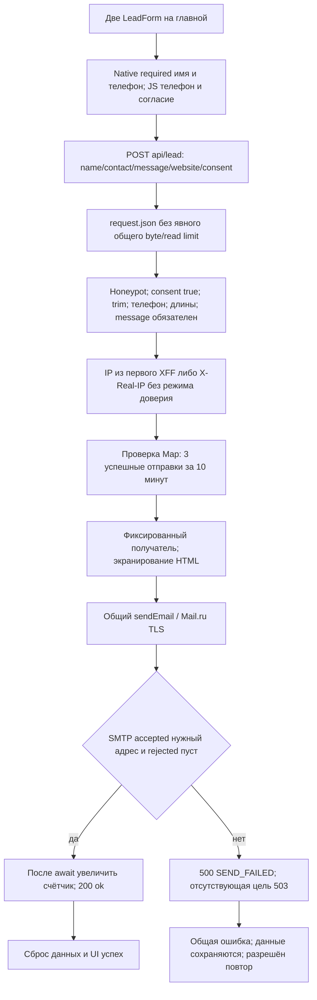
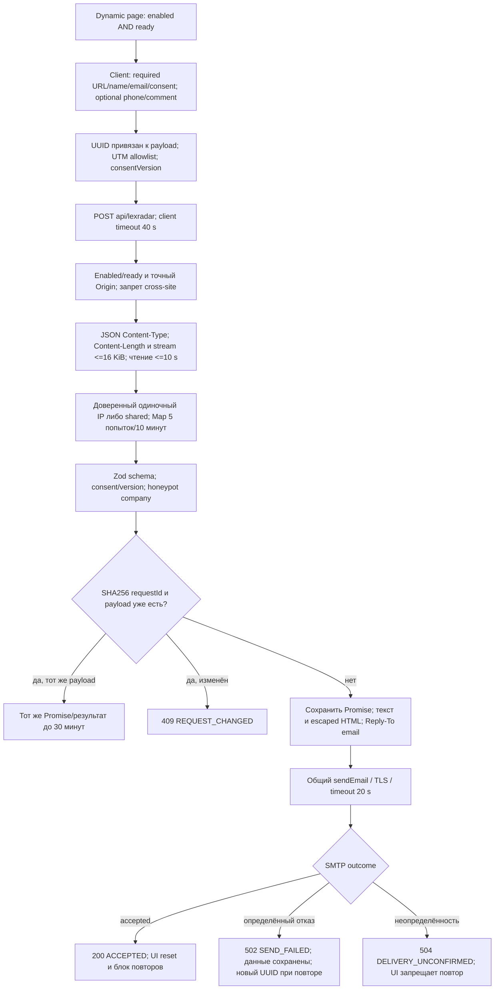

# Архитектура и потоки данных

Снимок: main `e8c85f5…`, 1.3.1. Ссылки на код в реестре проблем относятся к полному SHA из README.

## Рендеринг и границы

Next.js 16.4.2 App Router, React 19, TypeScript strict, Tailwind 4. `app/layout.tsx` — серверный layout, язык ru, тёмная тема, Geist/Geist Mono через next/font/google, общие cookies и условная production-аналитика. Шрифты скачиваются на этапе сборки; в public локальных шрифтов нет.

| Entry | Режим сборки | Состав |
| --- | --- | --- |
| `app/page.tsx` → `/` | static | Client HomePage + отдельный server Footer |
| `app/privacy/page.tsx` | static | Читает tracked `public/privacy.md` при рендеринге, ограниченный renderer |
| `app/lexradar/page.tsx` | force-dynamic | Server читает ready/enabled, передаёт клиентской форме только boolean |
| `app/lexradar/consent/page.tsx` | static | Текст согласия и общая CONSENT_VERSION v3 |
| `app/api/lead/route.ts` | dynamic POST | Независимый legacy обработчик общей формы |
| `app/api/lexradar/route.ts` | nodejs dynamic POST | Фабрика реального LexRadar handler |

Отсутствие `use client` не делает любой модуль серверным: импорт из client boundary включает его в клиентский граф. Статический граф от Next entries содержит 47 локальных файлов; он не заменяет bundler analysis. Серверные SMTP-модули в клиентский граф не входят. `lib/build-info.ts` использует child_process только со стороны Footer; `package.json` даёт version, `git rev-parse --short HEAD` — hash. У статического Footer это подпись момента сборки, не аттестация живого процесса/production. Без Git показывается только semver.

HomePage: Header → Hero → Problem → Solution (compact LeadForm) → Services → Process → Cases → Testimonials → Trust → LexRadarPromo → FinalCTA (contact LeadForm). Footer находится вне HomePage. Hero содержит встроенный consent banner; ConsentShell скрывает глобальный banner только на `/`. На остальных страницах баннер фиксирован снизу. Layout обеспечивает единый ConsentProvider.

## Навигация и взаимодействия

Header: якоря cases/services/testimonials/contact и LexRadarLink, mobile overlay с inert в закрытом состоянии, Escape, trap/возврат фокуса и снятие scroll-lock при resize. Hero сохраняет две CTA студии и переход LexRadar. Link переносит только пять UTM, по 200 символов, после hydration; произвольные query не копируются. Services/testimonials переключаются локальным состоянием; useInView делает reveal через IntersectionObserver; портфолио использует client-only shuffle/crossfade и fine-pointer tilt. LexRadar FAQ — нативные details. Автоматического crawler/аудитора, базы заявок и CRM в текущем графе нет.

## Общая форма: фактический поток

Origin/Sec-Fetch-Site/Content-Type, application-level общий byte/read limit, requestId и dedupe **в этом обработчике отсутствуют**. Счётчик увеличивается после SMTP: конкурирующие запросы проходят одновременно. Флаг LEXRADAR_FORM_ENABLED к нему не относится. На клиенте нет AbortSignal timeout и устойчивого requestId. Ошибка/неопределённый SMTP-результат сводятся к SEND_FAILED, повтор может дублировать письмо. Согласие имеет boolean и серверное время в письме, отдельной version у общей формы нет. Это описание существующего кода, не рекомендация обходить защиты.

## LexRadar: фактический поток

На схеме порядок body/IP упрощён для читаемости: IP и счётчик попыток проверяются **перед чтением stream**, после Content-Length. Ёмкость attempts 10 000, deliveries 5 000; ответы no-store, 429 Retry-After=600. Дедупликация действует только внутри одного процесса и 30 минут, не после рестарта и не между workers. При отсутствии доверенного IP все посетители делят shared bucket. Edge mode проверяет декларативный флаг и заголовок, но сам не устанавливает общий внешний limiter. URL сайта не загружается сервером: SSRF через поле site в текущем потоке отсутствует.

## SMTP и конфигурация

Оба обработчика используют email-service → smtp-config → Nodemailer. Только smtp.mail.ru, проверка TLS-сертификата и минимум TLS 1.2; implicit TLS или requireTLS для STARTTLS. LOGIN/PLAIN разрешены внутри защищённого транспорта. Отправитель задаётся сервером, получатель ограничен текущим служебным ящиком. Header CR/LF запрещены в to/subject/replyTo; пользовательские данные HTML экранируются. Успех требует accepted нужного адреса и пустого rejected, не просто messageId. Transport закрывается в finally, сырые ошибки наружу не возвращаются. SMTP acceptance не доказывает inbox.

## Cookies, аналитика и данные

Выбор хранится в localStorage `gol_consent_v1` с essential/analytics/timestamp/version=1.0; own server consent-cookie здесь не выставляется. До hydration/согласия Vercel Analytics не монтируется. beforeSend повторно читает сохранённое согласие и подавляет события после отзыва. Заблокированное storage оставляет выбор в памяти, после reload вопрос повторяется. Это отдельно от согласия на данные заявки. Реальная сеть Vercel Analytics на production не проверялась.

Данные заявки передаются в письмо, а не в БД. LexRadar держит hash payload/requestId и Promise результата, rate map — hash IP или shared; общая форма держит raw IP и счётчик. Формы хранят введённые данные в памяти браузера; UTM могут содержать пользовательский ввод, поэтому allowlist не гарантирует отсутствие ПД в значении. Владелец отдельно определяет сроки хранения писем и доступы.
