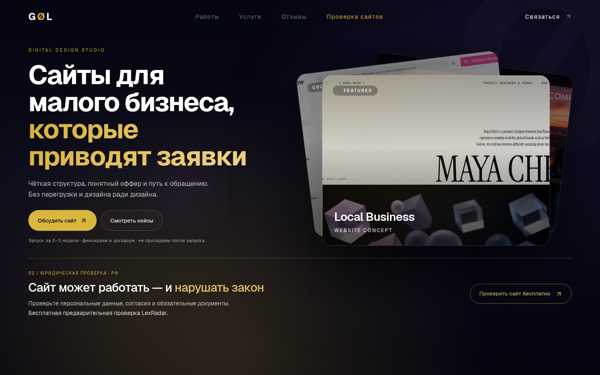
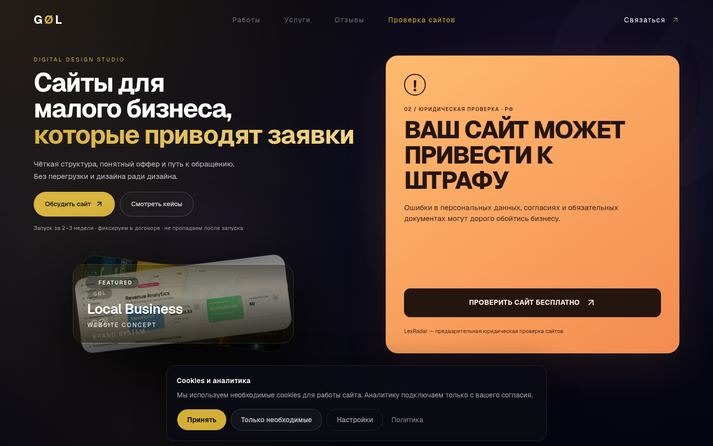
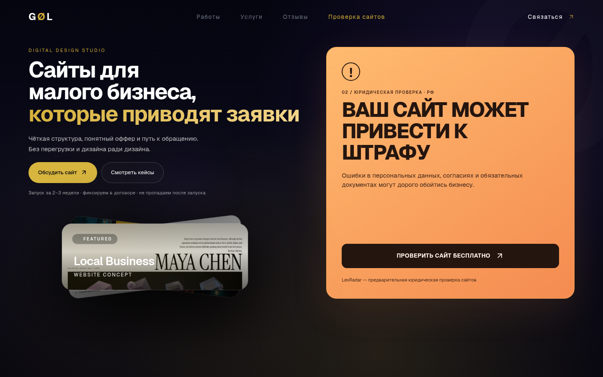
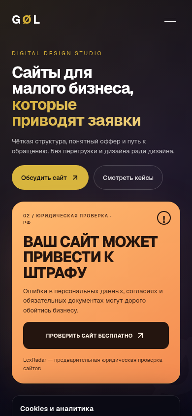

# GØL–LEXRADAR–005 — заметный рекламный блок на первом экране

База: `3591f7cbdcdd38cfe6bf0a2a0469fed13c24a9fd`. Ветка: `feat/lexradar-hardening-002`, PR №3.

На десктопе LexRadar занимает самостоятельную янтарную карточку справа, рядом с предложением веб-студии. Крупный заголовок «ВАШ САЙТ МОЖЕТ ПРИВЕСТИ К ШТРАФУ», условная формулировка риска, символ предупреждения и тёмная залитая кнопка создают отдельную визуальную иерархию. Изображения портфолио сохранены и уменьшены под текстом студии. На мобильных устройствах карточка расположена сразу после предложения студии, перед портфолио.

Утверждённый H1 и обе кнопки студии сохранены. Переход ведёт на `/lexradar`, включая существующее сохранение UTM. API, SMTP, юридические документы и форма заявок не изменены.

## Cookies

Только на главной баннер включён в поток hero после карточки LexRadar. Он не накладывается на заголовок или кнопку, включая раскрытые настройки. На остальных страницах сохранено прежнее фиксированное размещение. Компонент и обработчики согласий общие: аналитика по умолчанию выключена, доступны принятие, отказ и настройки. На мобильном первом экране баннер может находиться ниже границы окна; до него можно прокрутить страницу.

## Скриншоты и сравнение

Полные первые экраны локальной production-сборки Chromium, без обрезки до карточки. При сравнении фиксирован выбор изображений портфолио; анимации при снимке отключены.

| Вариант | Первый экран 1440×900 |
| --- | --- |
| №004, после закрытия cookies |  |
| №005, cookies открыты |  |
| №005, cookies закрыты |  |

Мобильный первый экран 390×844:

[Все снимки: 360, 390, 768, 1024, 1440 и 1920 px](lexradar-005-screenshots).

## Проверки

- `npm run check`: typecheck, ESLint, 50 unit/integration тестов и production build.
- Отдельная production-сборка после финальной правки CSS.
- `npm run test:browser`: **25/25 успешно**. Браузерная проверка шести размеров: отсутствие горизонтальной прокрутки, положение двух направлений и кнопки на десктопе в первом экране, отсутствие пересечений портфолио с текстом и рекламой, включая наведение.
- Открытый баннер, раскрытие настроек с выключенной аналитикой и отказ от аналитики; геометрическая проверка отсутствия перекрытия карточки.
- Переход в LexRadar с UTM, якоря студии, доступность и контраст hero через axe WCAG A/AA; регрессия существующей страницы LexRadar и формы на моках.
- Поддержка `prefers-reduced-motion` сохранена.

Логи проверок находятся в [lexradar-005-verification](lexradar-005-verification). Скриншоты подтверждают композицию; фактическая конверсия и восприятие за три секунды требуют проверки на посетителях.

Vercel проверяется отдельно по статусу конкретного коммита после push; результат и Preview фиксируются в PR №3. Скриншоты сделаны локально и не выдаются за снимки удалённого Preview. Merge в main и production deploy не выполнялись. Откат задания №005 — revert отдельного коммита; базовый вариант №004 сохранён в истории.
